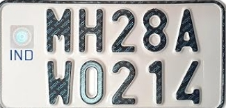
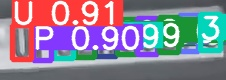

# License Plate Parser (YOLOv5)

Reads the text on a cropped license plate image by detecting each character with a custom-trained YOLOv5s model and putting the characters in reading order, including two-line plates.

| Sample input (`test_image.jpg`) | Character detections from an earlier run (`1710395685.7730865.jpg`) |
|---|---|
|  |  |

## Overview

Many plates, like the two-line plate in `test_image.jpg`, stack characters on two rows, so reading them is not simply left to right. This project treats every character as an object: a YOLOv5s model trained on 37 classes (A to Z, 0 to 9, and `?`) draws a box around each character on the plate. A short post-processing step then sorts the boxes from left to right, splits them into a top and a bottom line using the average vertical position of the boxes, and joins the two lines so that the one starting with a letter comes first. The resulting plate string is appended to `detections.txt`.

## Highlights

- `best.pt` is a YOLOv5s model fine-tuned from `yolov5s.pt` for 10 epochs at 640 px with batch size 16 and the SGD optimizer (training options stored inside the checkpoint).
- 37 character classes, listed in `classes.txt` and matching `nc: 37` in the checkpoint.
- The ordering step is about 30 lines at the end of `detect_number_plate.py`. The rest of the script is the Ultralytics YOLOv5 `detect.py`, so it accepts the usual inputs (image, folder, video, webcam).
- The YOLOv5 `models/` and `utils/` packages are included, so no separate YOLOv5 clone is needed to run inference.

## How the reading order works

1. Collect the top-left corner `(x, y)` and class of every detected character.
2. Sort the characters by `x`.
3. Compute the mean `y`. Characters at or above it form the top line, the rest the bottom line.
4. If the top line starts with a letter, the plate is `top + bottom`; otherwise `bottom + top`.

## Tech stack

Python, PyTorch, Ultralytics YOLOv5, OpenCV.

## Quickstart

```bash
git clone https://github.com/Kevinjoythomas/License-Plate-Parser-YOLOv5.git
cd License-Plate-Parser-YOLOv5
pip install -r requirements.txt
python detect_number_plate.py --weights best.pt --source test_image.jpg --conf-thres 0.4
cat detections.txt
```

The annotated image is saved under `runs/detect/exp*/`. The input should already be a cropped plate, because the repo has no step that finds the plate in a full scene.

## Project structure

```
detect_number_plate.py   YOLOv5 detect.py plus the character ordering step
best.pt                  trained character detector (37 classes)
classes.txt              class names in index order
test_image.jpg           sample plate
models/, utils/          Ultralytics YOLOv5 code (AGPL-3.0)
models/exp4/             training run of a separate three-class fire and smoke model (not used here)
export.py                YOLOv5 export script
common.py                duplicate of models/common.py
tutorial.ipynb           setup notebook (clones YOLOv5, short coco128 test run)
```

## Limitations and next steps

- One plate per run: detections from every image in `--source` are merged into a single string, and an image with no detections stops the ordering step with a division by zero.
- The line split uses the mean vertical position of all boxes, so a tilted single-line plate can be split into two lines by mistake.
- The training data and the evaluation results for `best.pt` are not in the repo, so its accuracy cannot be checked from here. The metrics in `models/exp4/` belong to the fire and smoke model, not to this parser.
- Next steps: add a plate detector in front of the character model, save a validation report for `best.pt`, and remove the unrelated `models/exp4/` run (about 35 MB) and the committed `__pycache__` folders.

## License

No license specified yet. This repository contains code from Ultralytics YOLOv5, which is licensed under AGPL-3.0, so any license added here needs to be AGPL-3.0.
